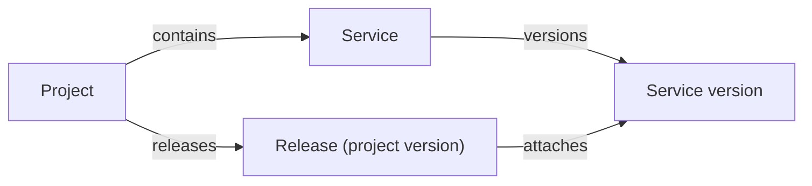
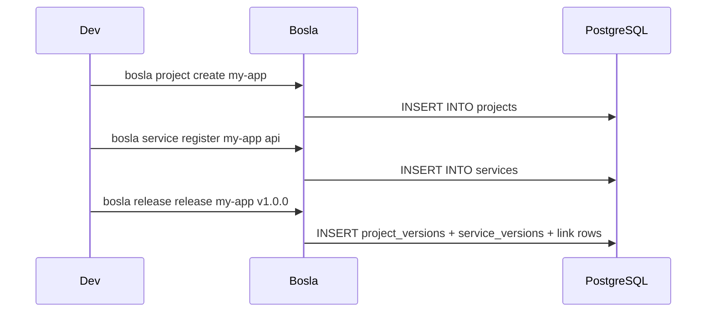

# Bosla

!!! abstract "A serious, well-scoped versioning tool."
    Bosla tracks **projects**, the **services** that belong to them, and the
    **releases** that ship a coordinated set of service versions.
    All state lives in a small PostgreSQL schema, and everything is driven
    by one CLI.

## Core concepts

| Concept   | Description                                                                 |
| --------- | --------------------------------------------------------------------------- |
| Project   | A top-level unit with a name, status, link, and description.                |
| Service   | A deployable component registered under a project (e.g. `koptan`, `ui`).    |
| Release   | A project version that pins each of its services to a specific version.     |
| Metadata  | Free-form key/value pairs attached to projects and services.                |

## How it fits together

## Next steps

- [Prerequisites](getting-started/prerequisites.md)
- [Installation](getting-started/installation.md)
- [Quickstart](getting-started/quickstart.md)

!!! note "Work in progress"
    Bosla is under active development. Commands and flags may change before
    the 1.0 release — check the [command reference](commands/overview.md)
    for the current surface.
