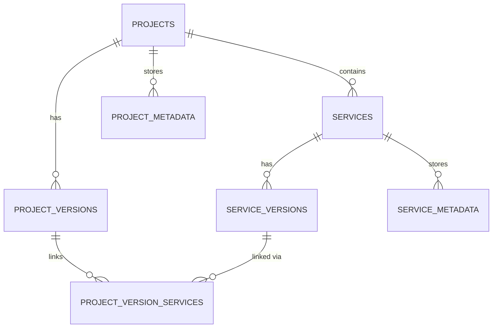

# Data model

Bosla stores everything in seven PostgreSQL tables, created by
`bosla configure init` from `sql/schema/schema.sql`.

## Tables

### `projects`

| Column        | Type          | Notes                          |
| ------------- | ------------- | ------------------------------ |
| `id`          | `SERIAL` PK   |                                |
| `name`        | `TEXT`        | `NOT NULL UNIQUE`              |
| `status`      | `TEXT`        | default `active`               |
| `link`        | `TEXT`        | default `''`                   |
| `description` | `TEXT`        | default `''`                   |
| `created_at`  | `TIMESTAMPTZ` | default `now()`                |
| `updated_at`  | `TIMESTAMPTZ` | default `now()`                |

### `services`

Unique per `(project_id, name)`. `repo_url` holds the service repository link.

| Column      | Type          | Notes                          |
| ----------- | ------------- | ------------------------------ |
| `id`        | `SERIAL` PK   |                                |
| `project_id`| `INTEGER`     | FK → `projects.id`, `ON DELETE CASCADE` |
| `name`      | `TEXT`        | `NOT NULL`, unique per project |
| `status`    | `TEXT`        | default `active`               |
| `description` | `TEXT`      | default `''`                   |
| `repo_url`  | `TEXT`        | default `''`                   |
| `created_at`| `TIMESTAMPTZ` | default `now()`                |
| `updated_at`| `TIMESTAMPTZ` | default `now()`                |

### `project_versions` (releases)

Unique per `(project_id, version)`.

| Column        | Type          | Notes                          |
| ------------- | ------------- | ------------------------------ |
| `id`          | `SERIAL` PK   |                                |
| `project_id`  | `INTEGER`     | FK → `projects.id`, `ON DELETE CASCADE` |
| `version`     | `TEXT`        | `NOT NULL`, unique per project |
| `description` | `TEXT`        | default `''`                   |
| `created_at`  | `TIMESTAMPTZ` | default `now()`                |

### `service_versions`

Unique per `(service_id, version)`.

| Column      | Type          | Notes                          |
| ----------- | ------------- | ------------------------------ |
| `id`        | `SERIAL` PK   |                                |
| `service_id`| `INTEGER`     | FK → `services.id`, `ON DELETE CASCADE` |
| `version`   | `TEXT`        | `NOT NULL`, unique per service |
| `status`    | `TEXT`        | default `''`                   |
| `git_hash`  | `TEXT`        | default `''`                   |
| `description` | `TEXT`      | default `''`                   |
| `created_at`| `TIMESTAMPTZ` | default `now()`                |

### `project_version_services` (release ↔ service version join)

Composite PK `(project_version_id, service_id)` — a release links each
service to exactly one service version. `ON DELETE CASCADE` on both sides.

### `project_metadata`

| Column       | Type          | Notes                            |
| ------------ | ------------- | -------------------------------- |
| `project_id` | `INTEGER`     | FK → `projects.id`, `ON DELETE CASCADE` |
| `key`        | `TEXT`        | PK (together with `project_id`)  |
| `value`      | `TEXT`        | default `''`                     |
| `created_at` / `updated_at` | `TIMESTAMPTZ` | default `now()`   |

### `service_metadata`

Same shape as `project_metadata`, keyed by `(service_id, key)`.

## Cascade behaviour

Deletes cascade through the foreign keys:

* deleting a **project** removes its services, releases, service versions,
  and all metadata;
* deleting a **service** removes its versions, its metadata, and its
  entries in releases (the `project_version_services` rows);
* deleting a **release** removes only its join rows — the underlying
  service versions remain.

## Indexes

| Index                          | Table                  |
| ------------------------------ | ---------------------- |
| `idx_projects_name`            | `projects`             |
| `idx_projects_status`          | `projects`             |
| `idx_services_name`            | `services`             |
| `idx_services_status`          | `services`             |
| `idx_project_versions_version` | `project_versions`     |
| `idx_service_versions_version` | `service_versions`     |
| `idx_service_versions_status`  | `service_versions`     |
| `idx_project_metadata_project_id` | `project_metadata` |
| `idx_service_metadata_service_id` | `service_metadata` |
